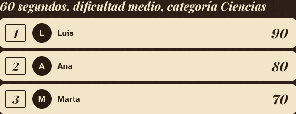

# Verificación y paridad con la web

Estado de la app iOS frente a la web (`gonzaga8200/quiz-game`, `origin/main` en `fdca967`, versión
0.31.0) a 27 de noviembre de 2026, rama `feat/v1`. Para cada función se indica cómo se ha
comprobado. Al final está lo que no se ha podido verificar y por qué.

## Resumen de las comprobaciones

| Comprobación | Resultado | Cómo repetirla |
|---|---|---|
| Núcleo del juego (`ContrarrelojCore`) con fixtures generados por el `core/` TypeScript de la web | 39 de 39 | `scripts/test-core.sh` (fixtures: `Tools/parity/run.sh`) |
| Tests unitarios de la app | 109 pasan; 2 omitidos (los de verificación manual: icono y producción) | `scripts/test-app.sh` |
| Tests de interfaz en iPhone 17 Pro (iOS 26.5) | 39 pasan; 5 omitidos (2 solo de iPad, 3 de verificación manual) | `scripts/test-ui.sh iphone` |
| Tests de interfaz en iPad Pro 13" M5 (iOS 26.5) | 41 pasan; 3 omitidos (los de verificación manual) | `scripts/test-ui.sh ipad` |
| Integración con los emuladores de Firebase y las reglas reales de la web | 5 de 5 | `scripts/test-integration.sh` |
| La web muestra en su ranking lo que escribió la app | Sí (captura abajo) | `scripts/cross-check-web.sh` |
| Banco de preguntas de producción (solo lectura), app frente a SDK web | Idénticos | ver «Producción» |
| Eventos de Firebase Analytics registrados por la app | Sí, con sus parámetros | `UITests/Verification/LiveAnalyticsCheck` |
| Capturas de todos los flujos, iPhone y iPad, claro y oscuro, texto AX5 | 64 capturas | `scripts/screenshots.sh` |
| Avisos del compilador en nuestros targets | 0 (los avisos son errores) | cualquier compilación |

## Paridad función a función

| Función (web) | En la app | Estado | Cómo se probó |
|---|---|---|---|
| Reglas: puntos por dificultad, penalizaciones, pases gratis y de pago, rachas y bonus de combo | `ContrarrelojCore` (port 1:1 de `core/`) | Igual | 12 partidas guionizadas de la web reproducidas al punto (`GameFixtureTests`), `GameRulesTests`, `ConstantsTests` |
| Generador aleatorio (mulberry32) y barajado | `Rng.swift` | Igual | Secuencias de la web con semillas fijas (`RngTests`) |
| Selección de preguntas: filtros, categoría, repartir categorías, memoria de vistas | `Selection.swift`, `SeenMemory` | Igual | 80 colas de la web reproducidas id a id (`SelectionTests`) |
| Informe: desglose, filas, celebración por nivel, confeti | `Report.swift`, `ReportScreen` | Igual | Fixtures de informe y celebración; `ReportTests` (UI) |
| Tablas del ranking (64 combinaciones) e ids | `Boards.swift` | Igual | `BoardsTests` frente a la lista de la web |
| Selección estable de 20 preguntas por categoría | `Showcase.swift` | Igual | Fixtures de la web (`ShowcaseTests`); `CategoriesTests` (UI) |
| Banco de preguntas desde Firestore (`status == active`) | `FirestoreQuestionSource` + caché de 24 h + copia incluida | Igual (+ sin conexión) | `QuestionBankTests`, `FirestoreMappingTests`, comprobación en producción |
| Inicio: reloj, título, lema, arcade, competitivo / Entrar, usuario, Síguenos | Pestaña Jugar | Igual | `ShellTests`, `CompetitiveFlowTests`, capturas 01, 02 y 11 |
| Modo competitivo: tiempo, dificultad, categoría, resumen, empezar | `SetupScreen` | Igual | `CompetitiveFlowTests`, captura 12 |
| Partida: HUD, tarjeta, feedback, sello «¡Fallo!», pasar, reportar (pausa), sonido, salir | `GameScreen` | Igual | `GameFlowTests` (8), capturas 03, 04 y 21–22 |
| Atajos de teclado (1–4, P) | iPad con teclado | Igual | `testKeyboardShortcutsAnswerAndSkip` (iPad) |
| Guardar en el ranking solo si mejora, posición, reintento | `RankingService` + Firestore | Igual | `RankingServiceTests`; integración `lowerScoreIsKept`, `positionCountsBetterPlayers`; `CompetitiveFlowTests` |
| Reglas de seguridad: enteros, mismo uid, solo mejoras | Mismas reglas | Igual | Integración `writesAreAcceptedByRules`, `otherUidCannotWrite` |
| Ranking: filtros, top 50, empates, «Tú», vacío, error, sin conexión | Pestaña Ranking | Igual salvo un detalle (abajo) | `RankingTests` (6), captura 07 |
| Reportar y ocultar jugadores (Guideline 1.2) | Menú de cada fila; Ajustes › Jugadores ocultos | Nuevo en la app | `RankingTests`, `SettingsTests/testUnhidePlayer` |
| Preguntas por categoría con respuestas | Pestaña Categorías | Igual (textos generados de `categories.ts`) | `CategoryCopyTests`, `CategoriesTests`, capturas 05–06 |
| Iniciar sesión con Google | Google Sign-In + Firebase Auth | Igual | Integración (credencial falsa en el emulador); UI con sesión falsa |
| Iniciar sesión con Apple | Sign in with Apple + Firebase Auth | Nuevo en la app | Solo UI con sesión falsa (ver «No verificado») |
| Borrar la cuenta y sus puntuaciones | Ajustes › Eliminar cuenta | Nuevo (exigido por Apple) | `AccountDeleterTests`, integración `deleteAccountRemovesAllBoards`, `SettingsTests` |
| Compartir resultado (texto y URL) | Hoja de compartir | Igual | `ReportTextsTests`, `ShareMethodTests`, `ReportTests`, analítica en vivo (`share`, `method = copy`) |
| Contacto (3 motivos) y reportar pregunta por correo | Mail / `mailto:` / copiar | Igual | `AppUtilsParityTests` (asuntos y cuerpos de la web), `SettingsTests`, `GameFlowTests` |
| Consentimiento de analítica (banner de cookies) | Tarjeta al primer arranque y Ajustes › Estadísticas | Igual | `ShellTests`, `SettingsTests`, `LocalStoresTests` |
| Analítica (page_view → screen_view, login_*, share; más game_start, game_end, question_report, account_deleted) | Firebase Analytics | Igual (+ eventos de la app) | `AnalyticsEventTests`; en vivo, ver «Analítica» |
| Sonido (síntesis) y silencio | `AVAudioEngine` | Igual | `SynthTests` (notas de la web) |
| Política de privacidad y aviso legal | Ajustes › Privacidad | Adaptados a la app | Revisados por el autor; `SettingsTests` |
| Redes (Instagram, X) | Inicio y Ajustes | Igual | `SettingsTests` |

### Diferencias conocidas

- **Puestos con empate en la lista del ranking.** La app da el mismo puesto a los empatados (1, 2, 2,
  4). La lista de la web numera por posición (1, 2, 3, 4), aunque el resultado tras una partida sí
  cuenta los empates. Decisión pendiente del autor: dejarlo así o igualarlo a la web.
- **Copia incluida de las preguntas.** Sale de `data/questions` de la web e incluye 209 preguntas
  activas que no están en Firestore (199 de Deportes y 10 de Música). Solo se usan si la app no
  puede descargar el banco. Se arregla importándolas a Firestore o regenerando la copia.

## Producción (solo lectura)

La app, por su propio camino de lectura (`FirestoreQuestionSource` + `FirestoreMapping`), y el SDK
web de Firebase desde Node leyeron las preguntas activas de `contrarreloj-quiz` el 27-11-2026:

| | SDK web | App iOS |
|---|---|---|
| Documentos activos | 2604 | 2604 |
| `count()` del servidor | 2604 | 2604 |
| Preguntas válidas tras leerlas | — | 2604 |
| SHA-256 de los ids ordenados | `b1bb0dcb…a044e` | `b1bb0dcb…a044e` |
| SHA-256 de «id:respuesta correcta» | `136f2572…abba9` | `136f2572…abba9` |

Esta comparación destapó un fallo que ya está corregido (`fix(data): read Firestore's 0 and 1 as
integers`). Firestore entrega los números como `NSNumber`, y un 0 o un 1 pasaba por booleano. La
app descartaba las preguntas cuya respuesta era la A o la B, y los jugadores con 0 o 1 fallos o
pases.

## Integración con los emuladores y la web

`scripts/test-integration.sh` arranca los emuladores de Auth y Firestore con el `firebase.json` y
las reglas de la web y ejecuta cinco tests con el código real de la app. Con las reglas anteriores
a la PR #93 de la web, el borrado de cuenta falla con «permission denied», como se esperaba; con
las de `main` pasan los cinco. Después, la web de `main` sobre los mismos emuladores muestra en
`/ranking` las puntuaciones que escribió la app:

## Analítica

Con la app real (sin falsos) y `-FIRDebugEnabled`, se aceptó la analítica, se jugó una partida
arcade y se compartió el resultado. El registro del simulador muestra `screen_view`, `game_start`,
`game_end` y `share` con los parámetros del spec ([analytics-events.txt](analytics-events.txt)),
además de los automáticos (`first_open`, `session_start`, `user_engagement`). También confirma que
el IDFA no está disponible.

El envío a Google no se pudo completar desde el Mac de pruebas: un proxy de inspección TLS de la red
sustituye el certificado de `app-analytics-services.com`, y el simulador no confía en él. Las
lecturas de Firestore no pasan por ese proxy. Falta ver los eventos en DebugView desde otra red o
desde un iPhone.

## Capturas

`screenshots/` (JPEG a media resolución) contiene, para iPhone 17 Pro y iPad Pro 13" en modo claro y oscuro, estas
pantallas: inicio con la tarjeta de consentimiento, inicio, partida, respuesta, categorías,
categoría, ranking, ajustes, privacidad, informe, inicio con sesión, modo competitivo, eliminar
cuenta y entrar. En iPad también la partida en horizontal. Además: inicio, partida y respuesta con
el texto más grande (AX5). Revisarlas sirvió para corregir cuatro cosas:

- el reloj de la partida mostraba «0:…» en algunos segundos;
- con el texto AX5, el marcador y las etiquetas partían palabras;
- en modo oscuro no se leían los títulos de sección de Ajustes;
- el botón «Entrar» de Ajustes tenía poco contraste.

## No verificado

| Qué | Por qué | Cómo cerrarlo |
|---|---|---|
| Sign in with Apple de principio a fin y la revocación del token al borrar la cuenta | Cuenta de Apple gratuita: sin la capacidad, sin «OAuth code flow» en Firebase | Pagar el Apple Developer Program, rellenar el proveedor Apple en Firebase y probar en TestFlight |
| Google Sign-In con una cuenta real en la app | Necesita iniciar sesión con una cuenta de Google en el simulador | Probarlo a mano en el simulador o en TestFlight |
| Eventos de analítica en DebugView / GA4 | El proxy de la red del Mac de pruebas corta el envío | Repetir `LiveAnalyticsCheck` desde otra red y mirar DebugView |
| Dispositivo físico (rendimiento, vibración, sonido audible, VoiceOver real) | Sin dispositivo con la cuenta gratuita en esta sesión | TestFlight o instalación local con la cuenta gratuita |
| iOS 17 y 18 | Solo hay simuladores de iOS 26 instalados | Instalar un runtime de iOS 17 y pasar las suites |
| Redactar el correo con la app Mail | El simulador no tiene cuenta de correo (se prueba el `mailto:` y el borrador falso) | Probarlo en un dispositivo |
| Borrar la cuenta en producción | Solo con los emuladores; las reglas de producción son las de `main` desde el 27-11-2026 | Probarlo con una cuenta de prueba en TestFlight |
